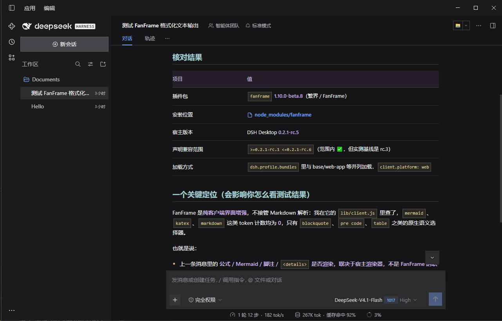
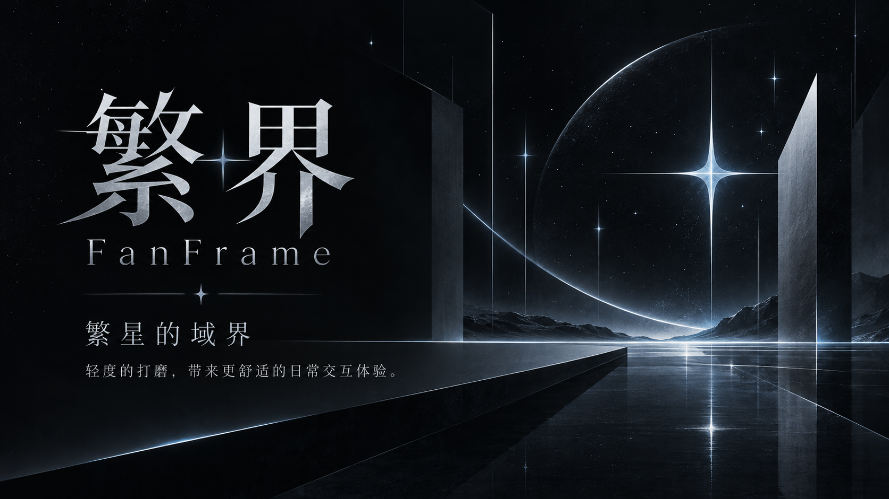

# 繁界 · FanFrame

繁界 - 意思是“繁星的域界”，这个插件通过对DSH桌面版的UI界面进行轻度的打磨，带来更舒适的日常交互体验。我为DSH带来了放置图标的统一侧边栏，给对话列表充足的空间，同时避免插件喜欢随意摆放自己的图标造成的混乱。此外，为对话正文增加了染色处理，让文字阅读更轻松愉快。最后，通过冷峻的无圆角风格和大量增加的细微交互动画，增加一些小小的精致感。

## 界面预览

## 主要功能

- **直角外观。** 统一界面的直角风格，调整侧栏会话标题的明暗层次。保留原生按钮和已有操作入口。
- **聊天阅读配色。** 整理 Markdown 标题、强调文字、行内代码、引用与表格的配色。相关文字颜色跟随宿主的浅色或深色主题调整。
- **悬停与聚焦反馈。** 为设置导航、输入框等控件补充状态反馈，保留设置项的当前选中态。沿用现有描边，不额外添加焦点外框。
- **短时动效。** 为部分控件、浮层和折叠区域补充过渡，让新出现的任务列表、目标栏与本地发送回显淡入。保留宿主已有动效，历史消息不补播，新增动效尊重“减少动态效果”设置。
- **侧栏与插件列表。** 整理窄图标栏布局，保留必要的滚动空间。插件列表支持搜索、恢复默认顺序，以及按名称升序或降序排列。
- **子智能体目录。** 用鼠标打开目录时默认定位到末尾，开始手动浏览后不持续吸底，已有键盘焦点保持可见。可查询到模型信息时，用提供方与模型名替换对应目录项的摘要；无法查询时保留原生摘要。

## 1.11 预览：正文图卡与阅读染色

- `fanframe_visualize` 在回复正文中渲染独立图卡。遇到可信的趋势、分布或对比时，工具指引优先用图形表达关系，只保留必要标签、图例和单位。关键结论仍保留在回复中。
- 新图卡可以用琥珀、雾蓝区分数据系列，以青绿标当前读数。图卡拥有统一的低对比直角外框，不随悬停提亮；历史图保持原有内容。
- 图卡提供 15 个内置 SVG 描边图标和原生交互控件，不需要 CDN。使用 `<svg viewBox="0 0 24 24" width="16" height="16" aria-hidden="true"><use href="#fanframe-icon-sun"/></svg>` 引用图标。
- 助手正文中的数字和成对括号只改字色；普通文字按标点稳定分成几个亮度档。仅处理与视口相交的正文块，不重写文字、链接、代码或公式。

## 版本与安装

本次 GitHub 预发布为 [`v1.11.0-beta.9`](https://github.com/AngleNaris/fanframe/releases/tag/v1.11.0-beta.9)。从 Release 下载 `fanframe-1.11.0-beta.9.tgz`，在 DSH 插件管理器中添加该本地包。npm 包名仍为 `fanframe`；这次 GitHub 预发布不更新 npm 渠道。

### 兼容范围

- **安装兼容声明：** `>=0.2.1-rc.1 <0.4.0-0`，包含 DSH Desktop `0.2.2-rc.1`。
- **此次实测：** DSH Desktop `0.2.2-rc.3` 的后台 Web 客户端。确认深色模式下旧图正常回放、卡框在鼠标进出时保持不变、新图系列色与天气图标正常显示，以及正文滚出视口后撤下染色。图内高亮移出后淡回、浅色模式和长流式性能未通过本次实机验收。
- **宿主依赖：** 部分样式与目录功能依赖 DSH 的界面结构和兼容接口。宿主升级后可能需要适配，不保证各版本呈现完全一致。

> **Desktop 0.2.1-rc.3 更新提示：** 宿主可能缓存旧的客户端注入版本。更新插件后先确认新版本是否生效；确需完整重载时，保存当前工作后正常退出并重新启动 Desktop，避免直接硬刷新页面。

### 从旧包迁移

`fanframe` 不是旧 `fan-de-hai` 的 npm 原位升级。已使用旧包时，请按以下顺序迁移：

1. 记录旧包版本，并保留回滚副本。
2. 禁用旧 `fan-de-hai` 插件或 bundle。
3. 安装并启用 `fanframe`，检查显示名称、图标和常用操作。
4. 确认正常后，再决定是否移除旧包。

不要同时启用两个包，也不要通过重命名安装目录来迁移。需要回滚时，先禁用 `fanframe`，再启用旧包。

## 使用边界

繁界调整的是已有界面的呈现和局部列表操作，不是模型接入、附件管理或图片查看器插件。它不替换原生图片查看器，也不宣称修复图片上传或存储问题。

同时使用其他修改全局主题、侧栏或浮层的插件时，样式可能互相覆盖。禁用或卸载繁界时，会清理插件自身添加的样式、监听、计时器和临时绘制层。

工程测试用于检查动效、清理与原生行为保留等实现约束，不能代替安装后的实际使用检查，也不是性能基准。分发包只包含运行文件、元数据、图标和必要文档，不包含工程夹具或本机审计资料。

## English

FanFrame (繁界) means “Fanxing’s realm.” This plugin lightly polishes the DSH Desktop UI to make everyday interactions more comfortable. I have added a unified sidebar for icons, giving the conversation list plenty of room while avoiding the clutter caused by plugins placing their icons wherever they like. I have also added color styling to conversation text to make reading easier and more enjoyable. Finally, an austere, square-cornered style and numerous subtle interaction animations add a small touch of refinement.

### Features

- **Sharp corners:** Apply a consistent angular appearance and adjust sidebar session-title contrast while retaining native controls.
- **Chat styling:** Refine Markdown headings, emphasis, inline code, quotations and tables, with text colors that follow the host's light or dark theme.
- **Interaction feedback:** Add hover or focus feedback to controls such as Settings navigation and the composer, using existing strokes without adding focus rings.
- **Subtle motion:** Add short transitions to selected controls, popups and disclosures, and fade in new task lists, goal bars and local submission echoes. Preserve native motion, skip historical messages and respect reduced-motion preferences for added effects.
- **Sidebar and plugin tools:** Refine the narrow icon rail and add plugin search, default ordering and ascending or descending name sorting.
- **Subagent catalog:** Start pointer-opened catalogs at the bottom without continuously overriding navigation or hiding keyboard focus. Show provider/model labels where the host can supply them; otherwise retain native summaries.

### Installation and compatibility

Download the installable archive from the [GitHub prerelease](https://github.com/AngleNaris/fanframe/releases/tag/v1.11.0-beta.9) and add it through the DSH Plugin Manager. This GitHub release does not update the npm channels.

The declared DSH engine range is `>=0.2.1-rc.1 <0.4.0-0`. Verification for this build covered the dark-theme Web client of DSH Desktop `0.2.2-rc.3`: historical chart replay, stable card borders, new chart colors and icons, and viewport-scoped text highlights. Chart point fade-out on leave, light-theme behavior, and long-stream performance remain unverified.

Disable the legacy `fan-de-hai` package before enabling FanFrame, and keep a rollback copy until migration is verified. Never enable both packages together. On Desktop `0.2.1-rc.3`, verify that an updated client has loaded; if a full reload is needed, save your work and restart Desktop normally rather than hard-refreshing its page.

FanFrame does not add a model service, change message content or sending logic, modify attachment storage, or replace the native image viewer. Other UI plugins can conflict with its styles. Engineering tests do not establish a full device-compatibility matrix or a performance guarantee.

## License

[MIT](<LICENSE>). The four-point-star and radial-line icon is distributed with the package.
